# Shelly Playground

**A walk-around training workshop for Shelly smart relays.** Build real-looking wall boxes, wire a Shelly in each one, switch lamps, sockets and blinds from the wall and from the app, connect a wireless sensor, and find electrical faults the safe way. There's no real electricity, so nothing can go wrong.

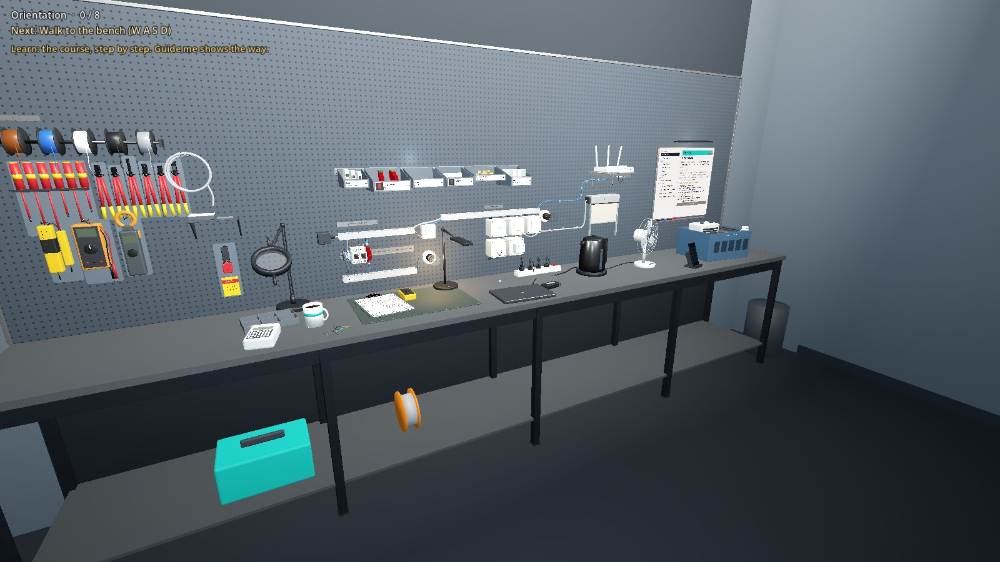

> **Free demo** · Windows and Linux · no installation · no internet needed · no electrical knowledge needed
>
> **[⬇ Download the demo](../../releases)**

---

## Contents

1. [What is Shelly Playground?](#1-what-is-shelly-playground)
2. [Who is it for?](#2-who-is-it-for)
3. [What you can do](#3-what-you-can-do)
4. [Download and start](#4-download-and-start)
5. [Your first five minutes](#5-your-first-five-minutes)
6. [Controls](#6-controls)
7. [The course (Learn)](#7-the-course-learn)
8. [The free workshop (Design)](#8-the-free-workshop-design)
9. [The devices in the workshop](#9-the-devices-in-the-workshop)
10. [The tools](#10-the-tools)
11. [Safety: what the simulator teaches, and what it doesn't](#11-safety-what-the-simulator-teaches-and-what-it-doesnt)
12. [Words you'll see](#12-words-youll-see)
13. [Your progress, settings and removing the demo](#13-your-progress-settings-and-removing-the-demo)
14. [If something goes wrong](#14-if-something-goes-wrong)
15. [Known limits of this demo](#15-known-limits-of-this-demo)
16. [What's coming](#16-whats-coming)
17. [Feedback](#17-feedback)
18. [Release history](#18-release-history)
19. [About](#19-about)

---

## 1. What is Shelly Playground?

**Shelly** devices are small smart relays. An electrician fits one inside a wall box, behind an ordinary light switch, socket or blind switch. After that:
- the light, socket or blind **still works from the wall switch**, as before;
- you can **also** switch it from a phone app, from automations, or from other devices;
- many Shellys **measure power**, so the app shows how much a lamp or a kettle uses.

**Shelly Playground** lets you learn all of this hands-on, in a virtual workshop, before you touch a real wall box. You walk around a small room with a training board on the wall, a bench, a tool wall, a parts shelf and a lesson board. Everything you see can be used: breakers, switches, sockets, tools, the Shellys themselves, even the window.

**What makes it more than a picture:** a real wiring engine checks every wire you make.
- A **dangerous wire is refused**, with the reason ("a short circuit: L straight to N").
- A **correct circuit really works**: the lamp lights from the wall switch, the socket measures the kettle, the blind runs up and down.
- A **mistake that isn't dangerous** but won't work shows up when you test, as it would in real life.

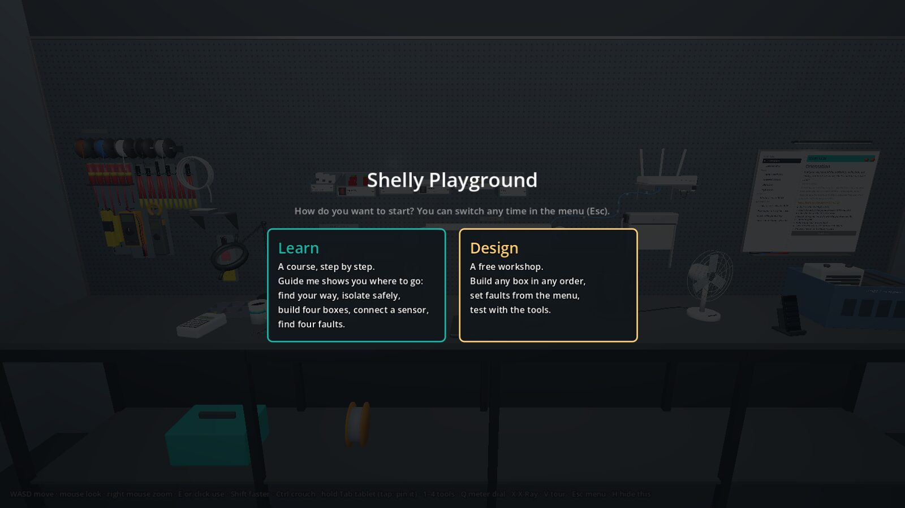

---

## 2. Who is it for?

- **Anyone curious about smart homes** who wants to understand what's inside the wall, with no risk.
- **Apprentice electricians and students**, to practise wiring and safe isolation as often as they like.
- **Electricians new to Shelly**, to see how each device is wired and what it can do before the first real job.
- **Trainers, support and sales teams**, to show and explain Shelly installations without a physical training board.

You don't need any electrical knowledge. The course explains everything as you go. Plan on **15 minutes** for a first look, or **about an hour** for the whole course.

---

## 3. What you can do

| | |
|---|---|
| **Build four wall boxes** | A lamp switch, a metered socket, a window blind, and a box with four push buttons. Take the right Shelly from the parts shelf, wire it in the box, close it and test it. |
| **Connect a wireless sensor** | Add a battery-powered **Shelly BLU Door/Window** sensor on the window to the app, tilt and open the window, and let it open the blind automatically. |
| **Make devices work together** | The four-button box's Shelly controls nothing itself: it reports each press, and **actions** in the app decide what happens (lamp on, blind down, everything off). You can change them. |
| **Isolate a circuit safely** | Switch off, lock off, prove your meter works, prove the circuit is dead, prove the meter again: the real routine, with a real-looking multimeter, socket tester and lock. |
| **Find four faults** | A leaky toaster that trips the safety switch, a missing earth, a short in a lamp, a loose wire. Find each one as an electrician would, fix it and test again. A short report follows. |
| **See electricity** | **X-Ray** dims the room and makes live wires and test points glow. |
| **Use the Shelly app** | A tablet in your hand shows every Shelly on the board: switch them, see power readings, move the blind, edit actions. |

<table>
<tr>
<td width="50%">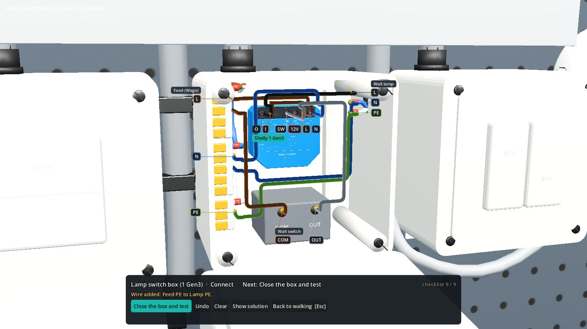 <b>Wiring a box:</b> labels as printed on each part, wires in tidy lanes.</td>
<td width="50%">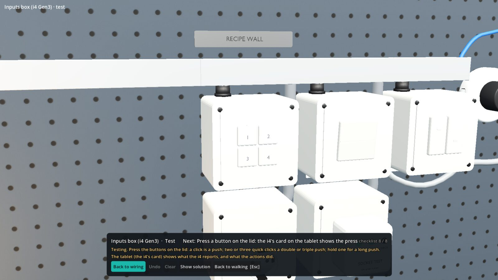 <b>The inputs box:</b> four push buttons, a Shelly i4 behind them.</td>
</tr>
<tr>
<td>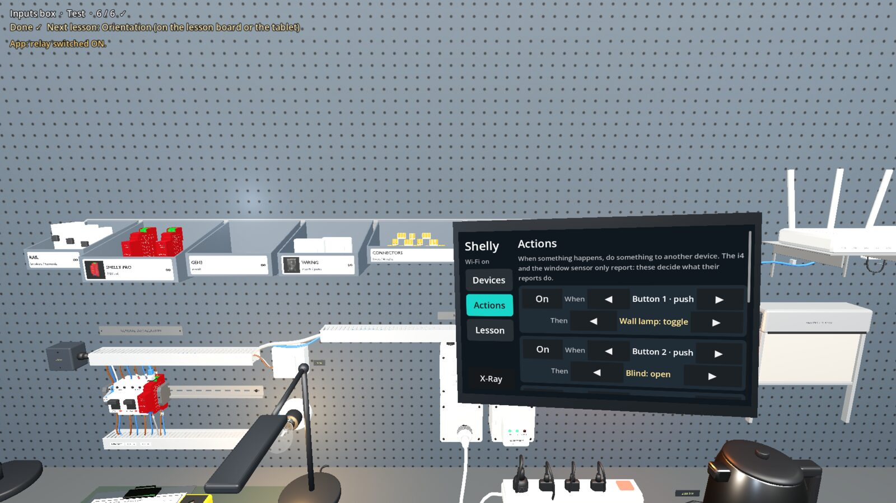 <b>Actions:</b> when this happens, do that, as in the Shelly app.</td>
<td>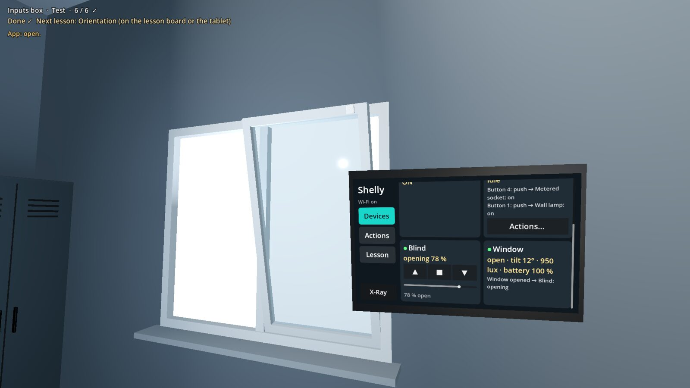 <b>The window sensor:</b> open or closed, tilt, light level, battery.</td>
</tr>
<tr>
<td>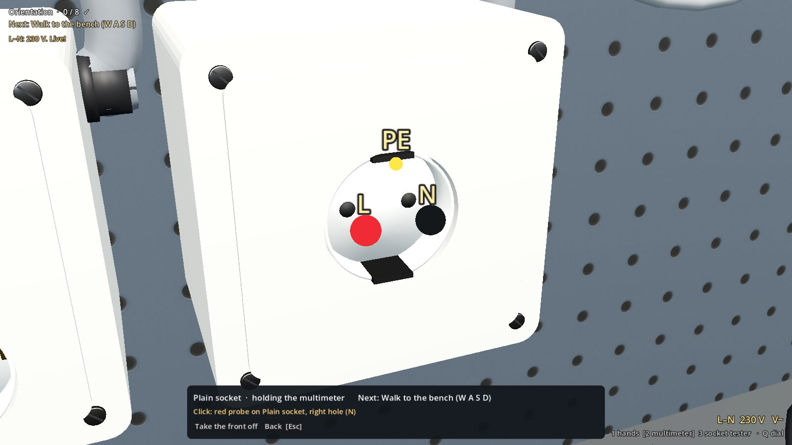 <b>The multimeter:</b> look closer at a socket and probe it.</td>
<td>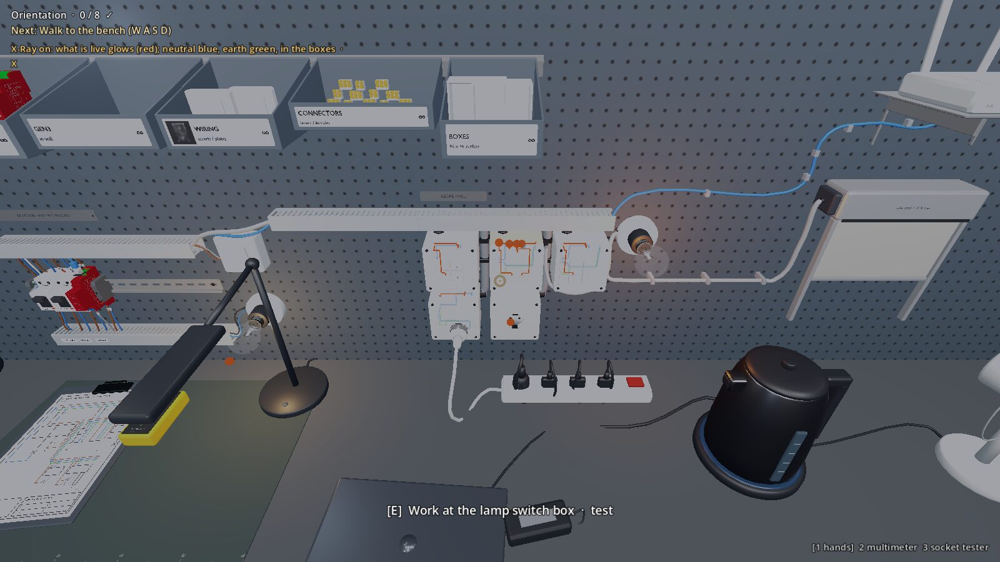 <b>X-Ray:</b> what's live glows.</td>
</tr>
<tr>
<td>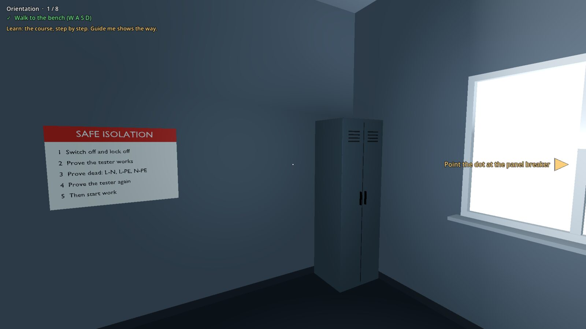 <b>Guide me:</b> a marker and an arrow show where to go next.</td>
<td>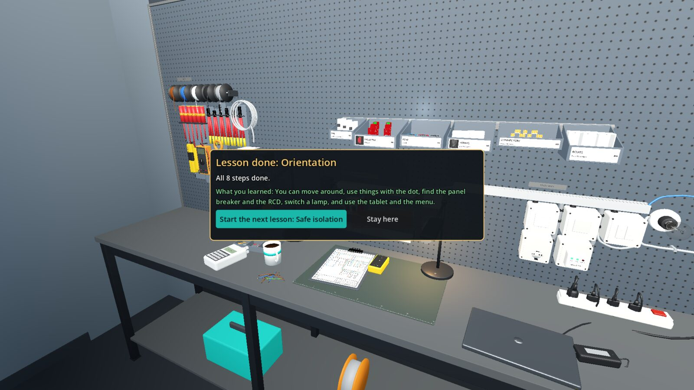 <b>A lesson done:</b> what you learned, and the next lesson.</td>
</tr>
</table>

---

## 4. Download and start

### What you need

| | Windows | Linux |
|---|---|---|
| **System** | Windows 10 or 11, 64-bit | A recent 64-bit Linux desktop: Linux Mint 21 or newer, Ubuntu 22.04 or newer, or similar |
| **Graphics** | Almost any graphics from about 2012 on (OpenGL 3.3) | The same; the standard open-source drivers work |
| **Disk space** | About 400 MB | About 400 MB |
| **Also** | A mouse and keyboard | A mouse and keyboard |

No installation, no account and no internet once you have the file. The demo doesn't change anything on your computer: it only saves your progress and settings in your user folder ([section 13](#13-your-progress-settings-and-removing-the-demo)).

### Download

1. Open the **[Releases page](../../releases)** (on the right of this page, under **Releases**).
2. Open the newest release and scroll down to **Assets**.
3. Click the file for your computer:
   - **Windows:** `Shelly_Playground_Stage4.8_Demo_Windows.zip`
   - **Linux:** `Shelly_Playground_Stage4.8_Demo_Linux.tar.gz`
4. Your browser saves it, usually in your **Downloads** folder.

### Windows: unzip and run

1. Open your **Downloads** folder.
2. **Right-click** the zip and choose **Extract All…**, then **Extract**. *Don't run the demo from inside the zip.*
3. In the new folder, **double-click** `ShellyPlayground_Stage4.8_Demo.exe`.
4. **Windows may warn you**, because the demo isn't signed by a big publisher. This is normal for small test builds.
   - If you see **"Windows protected your PC"**, click **More info**, then **Run anyway**.
   - If your antivirus asks, allow it.

### Linux (Mint, Ubuntu…): extract and run

1. Open your **Downloads** folder.
2. **Right-click** the `.tar.gz` file and choose **Extract Here**.
3. Open the new folder and **double-click** `ShellyPlayground_Stage4.8_Demo.x86_64`.
4. **If nothing happens,** or the file opens in a text editor, allow it to run once:
   - **Right-click** the file, choose **Properties**, open the **Permissions** tab, and tick **Allow executing file as program** (or **Is executable**). Close the window and double-click the file again.
   - Or, in a terminal in that folder: `chmod +x ShellyPlayground_Stage4.8_Demo.x86_64`, then `./ShellyPlayground_Stage4.8_Demo.x86_64`.
5. If your file manager asks whether to **Run** or **Display** the file, choose **Run**.

### The first start

The demo opens in a large window and asks **how you want to start**:
- **Learn:** a course, step by step. **Start here if you're new.** The first time, three short cards show how to move, how to use things, and how Guide me helps.
- **Design:** a free workshop. Build any box in any order and set faults yourself.

You can switch at any time in the menu (**Esc**, then **Mode**).

**The next time** you start the demo, it says **"Welcome back"** with what you've done. **Continue** carries on where you left off; **Start over** (it asks twice) clears your lessons.

**To quit:** press **Esc**, then **Quit** (or Alt+F4). Your progress is saved.

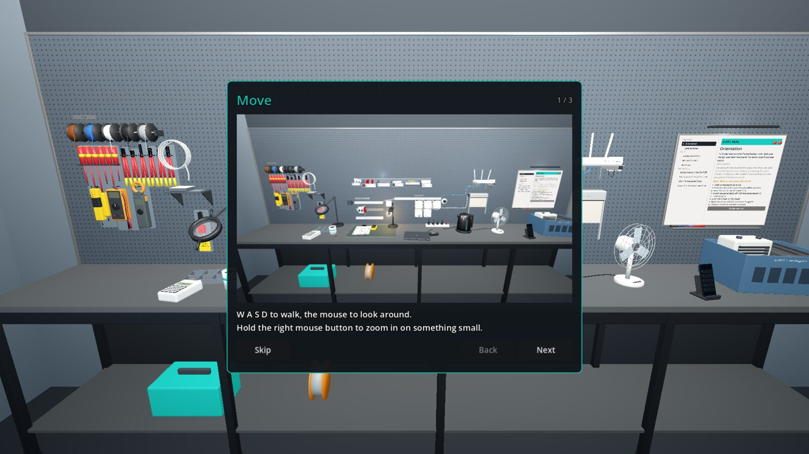

---

## 5. Your first five minutes

1. Choose **Learn**. Read the three welcome cards (or press Esc to skip them).
2. Look at the **Next** line at the top left: it always says what to do now. A **gold marker** floats over the next thing to use; if it's behind you, a **gold arrow** at the edge of the screen shows which way to turn.
3. Walk with **W A S D**, look with the **mouse**. Point the **dot** in the middle of the screen at the marked thing, and press **E** when a gold ring appears.
4. Follow **Orientation** to the end (about five minutes). It shows you the room, the breakers, the tablet and the menu.
5. A card says **"Lesson done"**. Click **Start the next lesson** and keep going, or **Stay here** and explore.

**Stuck?** After about 20 seconds on one step, the Next line adds where to look, and pressing **G** turns your view to it.

---

## 6. Controls

| Key / mouse | What it does |
|---|---|
| **Mouse** | Look around |
| **W A S D** (or arrow keys) | Walk |
| **Shift** (hold) | Walk faster |
| **Ctrl** or **C** | Crouch, to see the bench closely (press again to stand) |
| **Right mouse button** (hold) | Zoom in |
| **E** or **left click** | Use what the **dot in the middle of the screen** points at |
| **Tab** (hold) | Hold up the tablet (the Shelly app and your lesson) while you keep walking. Let go: it's away. |
| **Tab** (quick tap) | Pin the tablet up, with a mouse pointer to tap it. Tab again puts it away. |
| **1 2 3 4** | What you hold: **1** empty hands, **2** multimeter, **3** socket tester, **4** lock (once you've taken them) |
| **Q** | Turn the multimeter's dial: **V~** (volts) or **Ω** (ohms) |
| **X** | X-Ray: what's live glows |
| **G** | **Show me:** when you're stuck on a step, your view turns to the next thing to use |
| **V** | Tour: jump between fixed camera views (Left / Right arrows, or 1–9). V or Esc to walk again. |
| **Esc** | Pause menu: mode, places to go, settings, quit. At a box or a close view, Esc steps back. |
| **H** | Hide or show the controls line at the bottom |

**The dot in the middle of the screen:**
- A **gold ring** means "you can use this: press E".
- A **faint ring** with **"move closer"** means it's too far away. Walk to about an arm's length.

**Look closer:** at the places you work on (the plain socket, the panel lamp, a wall box, the toaster) the prompt says **"Look closer"**. Press **E** and the view glides in. Your mouse becomes a pointer: click the test points directly. **Esc** (or the right mouse button) steps back.

**Working at a wall box:**
- Click one terminal's label, then another, to make a wire. It's laid in its own lane.
- **Hover** a wire to see where it goes; **right-click** it to take it out.
- **Hover** a label to see what that terminal is for.
- **Mouse wheel** zooms, a **right-drag** turns the view a little, **Home** snaps back.
- **Show solution** draws the missing wires as see-through ghosts.
- **Close the box and test** puts the lid back on, so you can try it.

---

## 7. The course (Learn)

The **lesson board** (the whiteboard on the right of the bench) and the tablet (**Tab**, then **Lesson**) show the course. Each lesson is a list of steps that tick as you do them.

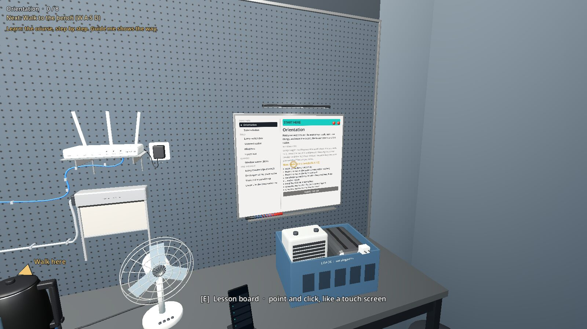

| Part | Lesson | What you do |
|---|---|---|
| **Start here** | **Orientation** | Walk, look, use things, the breakers, the tablet and the menu. |
| | **Safe isolation** | Make a socket safe to work on: switch off, lock off, prove the meter, prove dead, prove the meter again. |
| **Build** | **Lamp switch box** (Shelly 1 Gen3) | A wall switch and a lamp, with a Shelly between them. |
| | **Metered socket** (Shelly 1PM Gen3) | A socket the app can switch and measure. |
| | **Blind box** (Shelly 2PM Gen3) | A blind motor with up and down switches. |
| | **Inputs box** (Shelly i4 Gen3) | Four push buttons; each press is reported to the app. |
| **Connect** | **Window sensor (BLU)** | Add the wireless sensor, tilt and open the window, see what happens without a gateway, and let it open the blind. |
| **Find the fault** | **Leaky toaster trips the RCD** | Find which appliance leaks to earth. |
| | **Earth open at the plain socket** | The socket works, but its safety earth is missing. |
| | **Short in the panel lamp** | The breaker trips; find where. |
| | **Loose L in the lamp switch box** | The lamp flickers; find the loose wire. |

**You always know what's next:**
- **The Next line** says the step to do now. It flashes green "✓" when the step is done (with a soft tick), then shows the next one.
- **Guide me** (on by default in Learn) puts a gold marker over the next thing to use, an arrow at the screen's edge when it's out of view, and the key to press for key steps. At a wall box, the next wire's two terminals glow.
- **When a lesson is done,** a card says what you learned, with **Start the next lesson** or **Stay here**.
- **After a fault lesson,** a short debrief says what the fault was, how you found it, how long it took, and how many times you were stopped for working live.

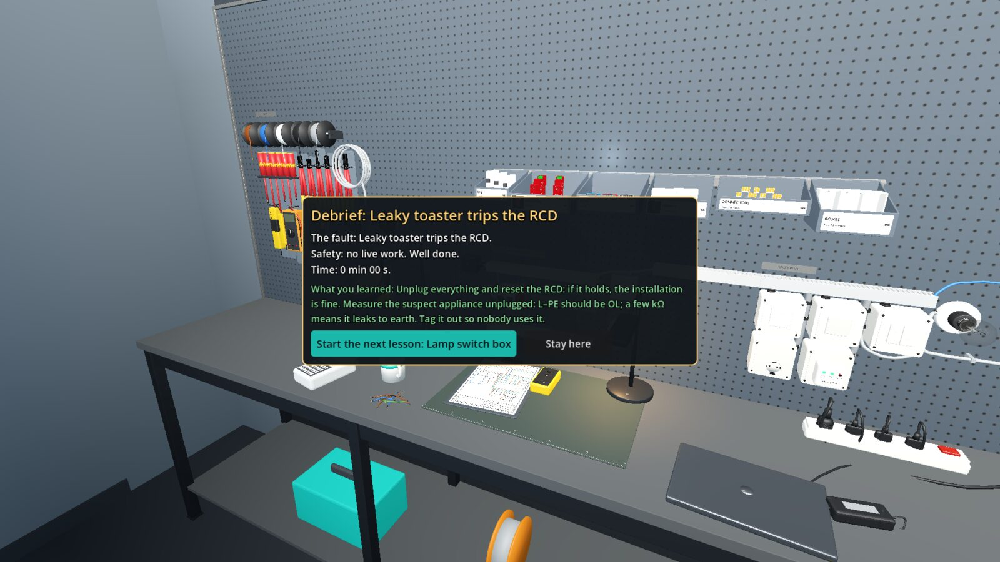

### Example: the lamp switch box (about 5 minutes)

1. On the lesson board, choose **Lamp switch box** (point at it and press **E**) and click **Guide me**.
2. **Take the Shelly:** follow the arrow to the **GEN3** bin on the parts shelf, point at the blue device and press **E**. The view glides to the wall box.
3. **Wire it:** the box's lid comes off. Each screw has a small label with what's printed on it (**L**, **N**, **SW**…), grouped under its part's name (**Feed (Wago)**, **Shelly 1 Gen3**, **Wall switch**, **Wall lamp**). The next wire's terminals glow gold. Try a mistake too: the feed's **L** to its **N** is a short circuit, and it's refused.
4. **Close the box and test** (the green button in the bottom bar).
5. **Switch the lamp:** click the switch on the box's lid. The wall lamp lights, and the lesson is done.

### Example: the inputs box and its actions

1. Build the **Inputs box** the same way: the i4's power (L and N), the push switch's common wire, and buttons 1 to 4 to the i4's inputs SW1 to SW4.
2. Close it and test, then press the buttons on its lid (walk up and press **E**, or click):
   - a click is a **push**;
   - two or three quick clicks are a **double** or **triple push**;
   - holding for about a second is a **long push**.
3. Open the tablet: the i4's card shows each press and what it did. The ready-made actions:

| When | Then |
|---|---|
| Button 1, push | Wall lamp on/off |
| Button 2, push | Blind up |
| Button 3, push | Blind down |
| Button 4, push | Metered socket on/off |
| Button 1, long push | **Everything off** (lamp and socket off, blind down) |
| Window opens | Blind up |

4. On the tablet's **Actions** page, change any of them with ◀ ▶, or turn one off. If a box isn't built yet, the log says so ("Blind: not installed"): the i4 still reports the press. That's the point of an input device: it's a messenger.

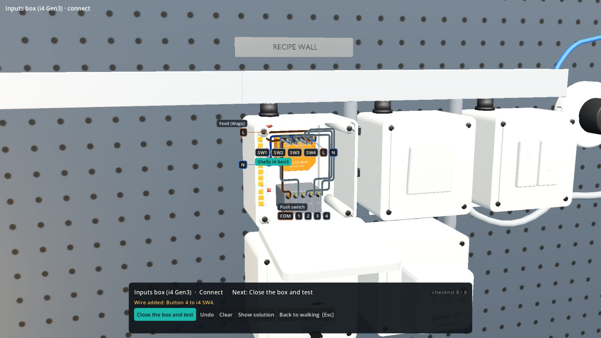

---

## 8. The free workshop (Design)

- The lesson board lists the boxes. Build any of them, in any order, with each box's own checklist.
- **Esc**, then **Trainer**: set a fault on the board (a short in the panel lamp, a loose L, an open earth) or plug in the faulty toaster, then find it with the tools.
- Working live is **warned about**, not refused, so you can see what happens.
- The window sensor and the actions work as soon as the sensor is added to the app.

---

## 9. The devices in the workshop

| Device | Where | What it shows you |
|---|---|---|
| **Shelly Pro 1PM** | DIN rail (the panel on the left) | A DIN-rail Shelly switching the panel lamp, with power metering. It also passes the window sensor's messages on to the app (a Bluetooth **gateway**). |
| **Shelly 1 Gen3** | Lamp switch box | The classic: a wall switch and a lamp, now also switchable from the app. |
| **Shelly 1PM Gen3** | Metered socket | Switches a socket and measures what's plugged in (try the kettle). |
| **Shelly 2PM Gen3** | Blind box | Runs a blind motor up and down, from the wall switches or the app. |
| **Shelly i4 Gen3** | Inputs box | Four inputs and **no relay**: it switches nothing itself, it reports button presses, and actions decide what they do. |
| **Shelly BLU Door/Window** | On the window | A battery sensor with no wires at all. It reports open or closed, how far the window is tilted, the light level and its battery, over Bluetooth through a gateway. |

The window is a **tilt-and-turn window**: use its handle to tilt it in at the top, open it fully, then close it.

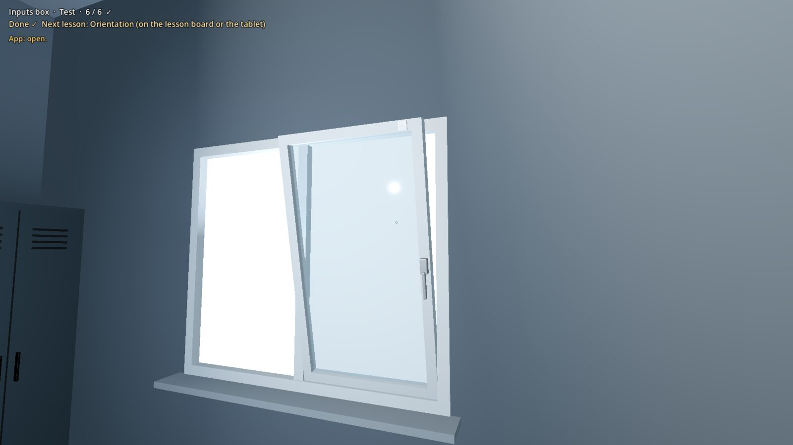

---

## 10. The tools

All on the **tool wall** (far left of the bench), except the socket tester (in the plain socket) and the proving unit (the yellow box on the work mat).

| Tool | How to use it |
|---|---|
| **Multimeter** | **E** on it to take it. **Q** turns the dial (volts or ohms). Click one test point for the red probe and another for the black: the meter reads between them, on its screen and at the bottom right. Ohms are refused on a live circuit. |
| **Proving unit** | **E** on it with the meter on volts: 230 V means your meter works. |
| **Socket tester** | **E** on it to take it out of the plain socket; with it in your hand (**3**), **E** on the socket plugs it back. Two green lamps: the socket is live and wired right. |
| **Lockout kit** | **E** on it to take its lock. With the lock in your hand (**4**), **E** on a breaker that's switched off locks it off, so nobody can switch it on. **E** on your lock takes it back. |

---

## 11. Safety: what the simulator teaches, and what it doesn't

**What it teaches:** the habits that keep electricians safe.
- **Isolate before you touch:** in the fault lessons, opening a socket or touching a wire while it's still live is **refused** ("Stop: this is still live. Isolate first."), and the debrief counts these moments.
- **Prove dead properly:** prove the meter on a known source, measure every pair of wires, prove the meter again.
- **Lock off:** a lock on the breaker means nobody can switch it back on while you work.

**What it doesn't do:** it is **not** a qualification and **not** a substitute for proper training.
- Real installations must follow your country's wiring rules, and in many countries only a qualified electrician may work on fixed wiring.
- The simulator's electrical model is simplified (see [section 15](#15-known-limits-of-this-demo)).
- **Never work on a live circuit in real life.**

---

## 12. Words you'll see

| Word | Meaning |
|---|---|
| **L** (live, phase) | The wire that carries the voltage. Brown. |
| **N** (neutral) | The return wire. Blue. |
| **PE** (protective earth) | The safety earth wire. Green-yellow. |
| **Feed** | The power coming into the box from the wall. |
| **Wago** | A lever connector that joins several wires. |
| **O / O1 / O2** | A Shelly's output: what it switches (the lamp, the socket, the blind motor). |
| **SW / S1 / S2 / SW1–SW4** | A Shelly's inputs: where the wall switch or buttons are connected. |
| **Relay** | The switch inside a Shelly that turns the power on and off. (The i4 has none.) |
| **Push, double push, long push** | The kinds of button press an input device tells apart. |
| **Action** | A rule in the app: "when this happens, do that". |
| **Gateway** | A powered Shelly that passes a battery sensor's Bluetooth messages on to the app. |
| **BLU** | Shelly's battery-powered Bluetooth devices. |
| **RCD** | A safety switch that cuts the power when current leaks to earth. |
| **Breaker** | A switch that cuts the power when too much current flows (a short or an overload). |
| **Isolate** | Switch a circuit off and lock it off, so nobody can switch it on while you work. |
| **Prove dead** | Measure that there's really no voltage, with a meter you've just proven works. |
| **OL** | "Open line": the multimeter sees no connection at all. |

---

## 13. Your progress, settings and removing the demo

**Progress and settings** (your lessons, the actions you edited, the sensor's pairing, mouse speed, interface size, sounds…) are saved automatically in your user folder:

| | Folder |
|---|---|
| **Windows** | `%APPDATA%\Godot\app_userdata\Shelly Playground - Stage 4.8 Demo` (paste this into the File Explorer address bar) |
| **Linux** | `~/.local/share/godot/app_userdata/Shelly Playground - Stage 4.8 Demo` (a hidden folder in your home folder: press Ctrl+H in the file manager to show hidden folders) |

**Settings** (Esc): mouse speed, field of view, invert mouse, corner pictures, **Sounds**, and **Interface size** (75 % to 150 %: bigger or smaller labels, bars and menus).

**Start over:** Esc, then **Start over** (click twice), or choose Start over on the start screen.

**Remove the demo:** delete the folder you extracted, and (if you like) the save folder above. Nothing else was installed.

---

## 14. If something goes wrong

| Problem | What to do |
|---|---|
| **Windows blocks the file** | Click **More info**, then **Run anyway**. If it still won't start, right-click the .exe, choose **Properties**, tick **Unblock**, then **OK**. |
| **Linux: double-clicking does nothing** | Allow the file to run (right-click, **Properties**, **Permissions**, **Allow executing file as program**), or run it from a terminal (see [section 4](#linux-mint-ubuntu-extract-and-run)). Running it from a terminal also shows any error messages. |
| **Black window, or it closes at once** | Update your graphics driver (Windows: from Intel, AMD or NVIDIA, or Windows Update; Linux Mint: the **Driver Manager**) and try again. |
| **The mouse is stuck in the window** | Press **Esc**: the pause menu frees the mouse. Click in the window to walk again. |
| **It runs slowly** | Make the window smaller. On a laptop, plug in the charger. Very old or very basic graphics can be slow. |
| **No sound** | Check the **Sounds** setting (Esc). On Linux, check your system's sound output. |
| **I'm lost in the room** | **Esc**, then **Go to**, then **In front of the bench**. |
| **I don't know what to do next** | Read the **Next** line at the top left. Turn on **Guide me** (on the lesson board, or Tab, then **Lesson**) and follow the marker or the arrow; stuck, press **G**. |
| **I want to start the course again** | **Esc**, then **Start over** (click twice). |
| **The text is too small (or too big)** | **Esc**, then **Interface size**. |

Still stuck? [Open an issue](../../issues) (see [section 17](#17-feedback)).

---

## 15. Known limits of this demo

This is an early demo, built in stages. Some things are simplified on purpose:
- **Wiring** is done by clicking each screw's label, not the screw itself.
- **Electrical detail:** the meter's readings come from a simple model of this board (230 V, 0 V, a few resistances), not a full circuit simulation.
- **Stand-in models:** the Shelly 2PM Gen3 and i4 Gen3 use a recoloured Shelly 1 Gen3 housing until their own models are added.
- **The tablet and the lesson board** are screens in the room: Interface size doesn't change them. Walk closer, or tap Tab to pin the tablet.
- **The tools in your hand** are simple shapes, not the detailed models on the tool wall.
- **Actions** are simple: one "when" and one "then". Scenes, conditions and schedules come later.
- **The workshop door** doesn't open.
- **Very slow computers:** quick double clicks on the push buttons may count as two single pushes.

---

## 16. What's coming

- **A live wiring diagram** beside the box: wire in the diagram or in 3D.
- **Keys that match where you are**, and **words explained** where they appear (hover RCD, PE, Wago).
- **Wiring on the screws themselves** in 3D.
- **More devices and jobs:** a dimmer, more BLU sensors (a button, a motion sensor, a door sensor), a free build with any part from the shelf.
- **The clamp meter**, to compare a cable's current with the Shelly's own reading.
- **Real power:** appliances with realistic power use; overloads trip breakers.
- **Smart home logic:** scenes, conditions and schedules across the devices.

---

## 17. Feedback

Feedback from people trying the demo for the first time is the most useful thing for this project.

- **Found a problem or have an idea?** [Open an issue](../../issues/new) and tell us:
  - what you did, what you expected, and what happened instead;
  - your computer (Windows or Linux, and which version);
  - a screenshot if you can (Windows: Win+Shift+S; Linux Mint: the Print Screen key).
- **Something confusing?** That counts too: if you didn't know what to do next, we want to know where.

---

## 18. Release history

| Release | What's new |
|---|---|
| **Stage 4.8** | The **inputs box** (Shelly i4 Gen3 with a four-button push switch) and **actions** in the app. The **tilt-and-turn window** with a **Shelly BLU Door/Window** sensor, its gateway, and "Window opens → open the blind". A new course part, **Connect**. Windows and Linux. |
| **Stage 4.7** | A friendlier course: an arrow at the screen edge, a clearer hint and **Show me** (G) when you're stuck, three welcome cards, a card when a lesson is done, and sounds. |
| **Stage 4.6** | Surface-mounted wall boxes with lids, labels as printed on each part, wires in tidy lanes, a start screen with Continue and Start over, and Interface size. |
| **Stage 4.5** | The course: Orientation, Safe isolation with real tools, four fault lessons with debriefs, X-Ray, and Design mode. |
| **Stage 4.4** | The walk-around workshop. |

---

## 19. About

Shelly Playground is built with the [Godot Engine](https://godotengine.org) (free and open source), and its workshop is modelled in [Blender](https://www.blender.org).

*Shelly and the Shelly device names are trademarks of Shelly Group. Device behaviour in the simulator is based on Shelly's public documentation and is simplified for training.*
